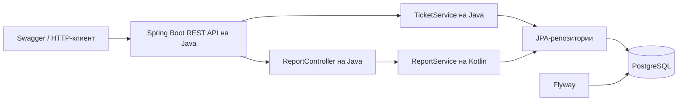
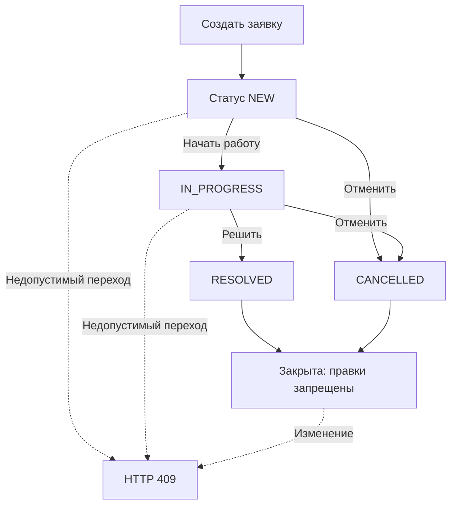
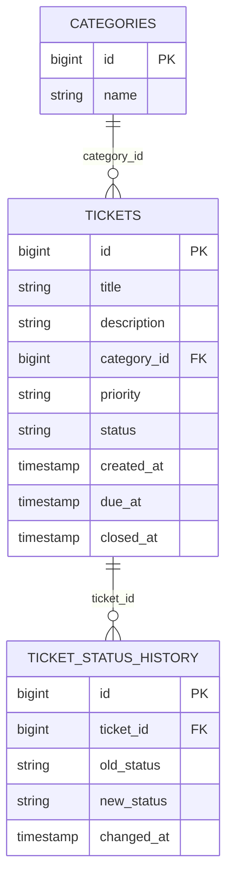

# Архитектура и диаграммы

## 1. Состав системы

Приложение представляет собой один Spring Boot-сервис с Java-контроллерами и бизнес-логикой и Kotlin-сервисом статистики. Данные хранятся в PostgreSQL. Flyway выполняет версионированные SQL-миграции при запуске.

## 2. Процесс обработки заявки

Каждый допустимый переход записывается в `ticket_status_history` в одной транзакции с обновлением `tickets`.

## 3. ER-диаграмма

Схема отражает сущности и логические связи. Точные SQL-типы и ограничения определяются `src/main/resources/db/migration/V1__create_tables.sql`.

## 4. Отчётный период

Для сводки используются заявки, удовлетворяющие условию `createdAt >= from AND createdAt < to`. Статусы и приоритеты считаются по этой же выборке. Среднее время решения вычисляется по завершённым заявкам как `closedAt - createdAt`. Если завершённых нет, возвращается `null`.

## 5. Развёртывание

Локальный `compose.yaml` собирает приложение и запускает PostgreSQL с постоянным томом. `compose.deploy.yaml` скачивает опубликованный образ из GHCR по полному SHA коммита и разворачивает его с отдельным томом БД на порту 8081.
